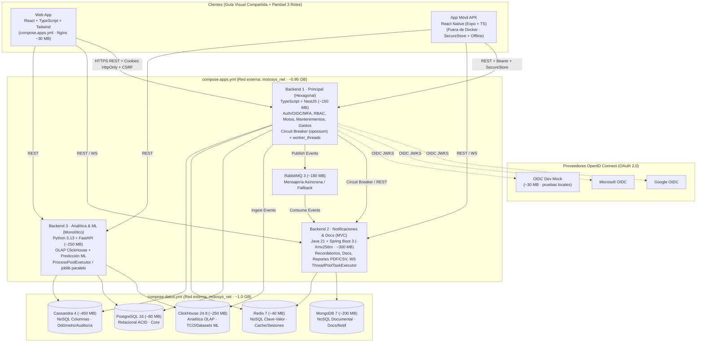

# Plan de Arquitectura e Implementación — MotoSys (2026-2)

## 1. Objetivo y Contexto

Construir **MotoSys: Plataforma de Gestión Integral para Motociclistas**, cumpliendo las exigencias de **Programación Avanzada** (Instructivo Proyecto Final 2026-2) y **Arquitectura de Software** (escenarios de calidad, tácticas Cache-Aside, Circuit Breaker, JWT+RBAC, diagramas C4 y ADD), con perfil de memoria calibrado para equipos de **8 GB de RAM** (~2.0 GB RAM total en Docker).

- **Autores**: Fabian Andrés Coral García · Jorge Arnulfo Montoya Manchola
- **Repositorio**: `https://github.com/fabiabi1234657/MOTOSYS-PROYECTO-`
- **Fechas**: Entrega Moodle/GitHub: **25 de noviembre de 2026** · Sustentación con APK: **2 de diciembre de 2026**

---

## 2. Arquitectura del Sistema

---

## 3. Infraestructura Docker (Dos Archivos Compose Aislados)

1. **`infra/compose.datos.yml`**: Exclusivamente los **5 motores de datos** unidos a la red externa `motosys_net`, con versiones fijadas, volúmenes persistentes, inicialización, healthchecks y límites de memoria:
   - `postgres:16.4-alpine` (`mem_limit: 192m`)
   - `mongo:7.0.14` (`--wiredTigerCacheSizeGB 0.25`, `mem_limit: 320m`)
   - `redis:7.4.1-alpine` (`--maxmemory 64mb --appendonly yes`, `mem_limit: 96m`)
   - `cassandra:4.1.6` (`MAX_HEAP_SIZE=320M`, `HEAP_NEWSIZE=96M`, `mem_limit: 640m`)
   - `clickhouse/clickhouse-server:24.8-alpine` (`max_server_memory_usage=268435456`, `mem_limit: 384m`)
2. **`infra/compose.apps.yml`**: Los 3 backends + `rabbitmq:3.13-alpine` + `oidc-dev` + `frontend-web`, con `Dockerfile` multietapa, `.dockerignore`, usuario sin privilegios (`USER`), healthchecks y red externa `motosys_net`.

---

## 4. Modelo de Datos Políglota (Fuente de Verdad y Unicidad)

Todos los motores comparten identificadores **UUID v4** (`user_id`, `workshop_id`, `motorcycle_id`, `maintenance_id`, `expense_id`).

| Motor | Categoría | Fuente de Verdad | Índices `UNIQUE` e Integridad |
| :--- | :--- | :--- | :--- |
| **PostgreSQL 16** | Relacional (SQL) | `users`, `user_identities`, `workshops`, `motorcycles`, `maintenances`, `expenses`, `service_invoices`, `idempotency_keys` | `UNIQUE(LOWER(email))`, `UNIQUE(doc_type, doc_jurisdiction, doc_number)`, `UNIQUE(UPPER(plate))`, `UNIQUE(workshop_id, sku_code)`, `UNIQUE(invoice_series, invoice_number)`. |
| **MongoDB 7** | NoSQL Documental | `vehicle_documents`, `notifications`, `reminders`, `user_preferences`, `maintenance_templates` | `UNIQUE(motorcycleId, fileHash)`, `UNIQUE(userId)` en preferencias. |
| **Redis 7** | NoSQL Clave-Valor | Caché (`cache:*`, TTL 300s/30s) y Sesiones/Revocación (`session:*`, `jwt:revoked:*`, `rl:login:*`) | Prefijos separados; nunca compartir caché privada entre usuarios; métricas `hits/misses/latency`. |
| **Cassandra 4** | NoSQL Columnas Anchas | `odometer_readings_by_moto` y `audit_events_by_day` | Append-only particionado por moto/día; auditoría inmutable. |
| **ClickHouse 24.8** | Analítica (OLAP) | `fact_vehicle_events` (TCO, costos por categoría/marca/taller/mes, datasets ML) | Dimensiones: fecha, marca, modelo, año, categoría, tipo, taller. Medidas: costo, km, días entre servicios, conteo. Granularidad: evento + rollup diario/mensual. |

---

## 5. Backends, Concurrencia y Contratos OpenAPI

1. **Backend 1 (`services/core-nestjs` — TypeScript + NestJS · Arquitectura Hexagonal)**:
   - Capas: `domain/`, `application/ports/in`, `application/ports/out`, `application/use-cases/`, `infrastructure/adapters/in` y `out`.
   - Concurrencia: E/S asíncrona acotada, transacciones con índices `UNIQUE` (`409 Conflict` ante carreras) y piscina de **`worker_threads`** para cálculo intensivo por lotes.
2. **Backend 2 (`services/notify-java` — Java 21 + Spring Boot 3 · Arquitectura MVC)**:
   - Capas: `controller/`, `service/`, `repository/`, `model/`.
   - Concurrencia: **`ThreadPoolTaskExecutor`** acotado con timeouts y cierre ordenado para despacho concurrente de alertas y generación de reportes PDF/CSV.
3. **Backend 3 (`services/analytics-python` — Python 3.13 + FastAPI · ML Monolítico Paralelo)**:
   - Analítica OLAP sobre ClickHouse + predicción de mantenimientos/costos con `scikit-learn`.
   - Paralelismo: **`ProcessPoolExecutor` / `joblib`** con benchmark reproducible (`random_state=42`) comparando secuencial (`workers=1`) vs paralelo (`workers=N`).

---

## 6. Identidad, Sesiones, RBAC y Clientes

- **OIDC sobre OAuth 2.0**: Google + Microsoft (por `.env`) + proveedor local `oidc-dev`. El proveedor identifica; MotoSys asigna el rol local.
- **Contraseña local (NIST SP 800-63B-4 / OWASP)**: ≥15 chars sin MFA / ≥8 con MFA; frases ≥64 chars; rechazo de contraseñas comunes; **Argon2id**; límite de intentos (5/min → bloqueo 15 min); recuperación segura; **MFA TOTP obligatorio** para admins.
- **Sesiones**: JWT 15 min + Refresh opaco con rotación/revocación en Redis (inactividad 30 min, absoluta 8 h). Web: cookies `HttpOnly/Secure/SameSite` + CSRF. Móvil: `expo-secure-store`.
- **Roles y Paneles**: `SUPER_ADMIN` (control global, seed controlado), `WORKSHOP_ADMIN` (ámbito de taller, 2.º nivel), `RIDER` (cuenta personal, protección IDOR).
- **Web + Móvil**: React + TS + Tailwind (Web) y React Native Expo + TS (APK Android) con guía visual compartida (`#F59E0B`, `#0F172A`, `#F8FAFC`, `Inter` + `JetBrains Mono`), paridad funcional para los 3 roles, accesibilidad WCAG 2.2 AA y soporte offline en móvil.

---

## 7. Plan de Pruebas (≥14 Pruebas Automatizadas)

1. Política de contraseñas NIST + Argon2id.
2. Bloqueo por fuerza bruta + registro inmutable en Cassandra.
3. MFA TOTP obligatorio para `SUPER_ADMIN` y `WORKSHOP_ADMIN`.
4. Verificación OIDC + asignación de rol local.
5. Matriz RBAC y protección IDOR por objeto (`403`).
6. Dos altas simultáneas sobre índice `UNIQUE` (`201` + `409 Conflict`).
7. Idempotencia (`Idempotency-Key`) en gasto/mantenimiento.
8. Redis Cache-Aside (`miss` → `hit`), invalidación y métricas.
9. Circuit Breaker (`opossum`) + fallback RabbitMQ ante caída de `notify-java`.
10. `worker_threads` en `core-nestjs` (responsividad del event loop).
11. `ThreadPoolTaskExecutor` concurrente en `notify-java`.
12. Documentos (índice único) y recordatorios en MongoDB.
13. Benchmark ML secuencial vs paralelo reproducible en `analytics-python`.
14. Consultas OLAP agregadas en ClickHouse consistentes con PostgreSQL.
