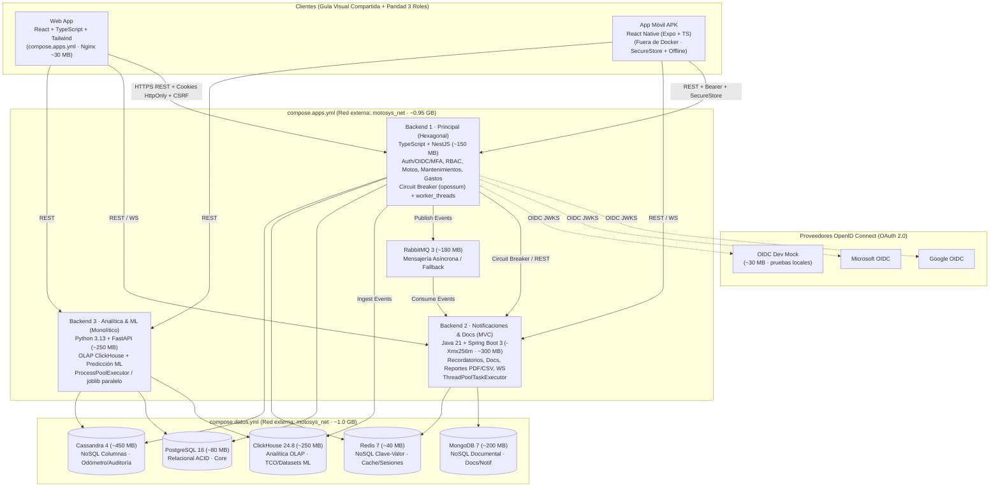

# Plan de Arquitectura e Implementación — MotoSys (2026-2)

Consulta la sección **Plan de Continuación** al final para las fases 2B a 6 y el contrato vigente de sesiones opacas.

## 1. Objetivo y Contexto

Construir **MotoSys: Plataforma de Gestión Integral para Motociclistas**, cumpliendo las exigencias de **Programación Avanzada** (Instructivo Proyecto Final 2026-2) y **Arquitectura de Software** (escenarios de calidad, tácticas Cache-Aside, Circuit Breaker, JWT+RBAC, diagramas C4 y ADD), con perfil de memoria calibrado para equipos de **8 GB de RAM** (~2.0 GB RAM total en Docker).

- **Autores**: Fabian Andrés Coral García · Jorge Arnulfo Montoya Manchola
- **Repositorio**: `https://github.com/fabiabi1234657/MOTOSYS-PROYECTO-`
- **Fechas**: Entrega Moodle/GitHub: **25 de noviembre de 2026** · Sustentación con APK: **2 de diciembre de 2026**

---

## 2. Arquitectura del Sistema

---

## 3. Infraestructura Docker (Dos Archivos Compose Aislados)

1. **`infra/compose.datos.yml`**: Exclusivamente los **5 motores de datos** unidos a la red externa `motosys_net`, con versiones fijadas, volúmenes persistentes, inicialización, healthchecks y límites de memoria:
   - `postgres:16.4-alpine` (`mem_limit: 192m`)
   - `mongo:7.0.14` (`--wiredTigerCacheSizeGB 0.25`, `mem_limit: 320m`)
   - `redis:7.4.1-alpine` (`--maxmemory 64mb --appendonly yes`, `mem_limit: 96m`)
   - `cassandra:4.1.6` (`MAX_HEAP_SIZE=320M`, `HEAP_NEWSIZE=96M`, `mem_limit: 640m`)
   - `clickhouse/clickhouse-server:24.8-alpine` (`max_server_memory_usage=268435456`, `mem_limit: 384m`)
2. **`infra/compose.apps.yml`**: Los 3 backends + `rabbitmq:3.13-alpine` + `oidc-dev` + `frontend-web`, con `Dockerfile` multietapa, `.dockerignore`, usuario sin privilegios (`USER`), healthchecks y red externa `motosys_net`.

---

## 4. Modelo de Datos Políglota (Fuente de Verdad y Unicidad)

Todos los motores comparten identificadores **UUID v4** (`user_id`, `workshop_id`, `motorcycle_id`, `maintenance_id`, `expense_id`).

| Motor | Categoría | Fuente de Verdad | Índices `UNIQUE` e Integridad |
| :--- | :--- | :--- | :--- |
| **PostgreSQL 16** | Relacional (SQL) | `users`, `user_identities`, `workshops`, `motorcycles`, `maintenances`, `expenses`, `service_invoices`, `idempotency_keys` | `UNIQUE(LOWER(email))`, `UNIQUE(doc_type, doc_jurisdiction, doc_number)`, `UNIQUE(UPPER(plate))`, `UNIQUE(workshop_id, sku_code)`, `UNIQUE(invoice_series, invoice_number)`. |
| **MongoDB 7** | NoSQL Documental | `vehicle_documents`, `notifications`, `reminders`, `user_preferences`, `maintenance_templates` | `UNIQUE(motorcycleId, fileHash)`, `UNIQUE(userId)` en preferencias. |
| **Redis 7** | NoSQL Clave-Valor | Caché (`cache:*`, TTL 300s/30s) y Sesiones/Revocación (`session:*`, `jwt:revoked:*`, `rl:login:*`) | Prefijos separados; nunca compartir caché privada entre usuarios; métricas `hits/misses/latency`. |
| **Cassandra 4** | NoSQL Columnas Anchas | `odometer_readings_by_moto` y `audit_events_by_day` | Append-only particionado por moto/día; auditoría inmutable. |
| **ClickHouse 24.8** | Analítica (OLAP) | `fact_vehicle_events` (TCO, costos por categoría/marca/taller/mes, datasets ML) | Dimensiones: fecha, marca, modelo, año, categoría, tipo, taller. Medidas: costo, km, días entre servicios, conteo. Granularidad: evento + rollup diario/mensual. |

---

## 5. Backends, Concurrencia y Contratos OpenAPI

1. **Backend 1 (`services/core-nestjs` — TypeScript + NestJS · Arquitectura Hexagonal)**:
   - Capas: `domain/`, `application/ports/in`, `application/ports/out`, `application/use-cases/`, `infrastructure/adapters/in` y `out`.
   - Concurrencia: E/S asíncrona acotada, transacciones con índices `UNIQUE` (`409 Conflict` ante carreras) y piscina de **`worker_threads`** para cálculo intensivo por lotes.
2. **Backend 2 (`services/notify-java` — Java 21 + Spring Boot 3 · Arquitectura MVC)**:
   - Capas: `controller/`, `service/`, `repository/`, `model/`.
   - Concurrencia: **`ThreadPoolTaskExecutor`** acotado con timeouts y cierre ordenado para despacho concurrente de alertas y generación de reportes PDF/CSV.
3. **Backend 3 (`services/analytics-python` — Python 3.13 + FastAPI · ML Monolítico Paralelo)**:
   - Analítica OLAP sobre ClickHouse + predicción de mantenimientos/costos con `scikit-learn`.
   - Paralelismo: **`ProcessPoolExecutor` / `joblib`** con benchmark reproducible (`random_state=42`) comparando secuencial (`workers=1`) vs paralelo (`workers=N`).

---

## 6. Identidad, Sesiones, RBAC y Clientes

- **OIDC sobre OAuth 2.0**: Google + Microsoft (por `.env`) + proveedor local `oidc-dev`. El proveedor identifica; MotoSys asigna el rol local.
- **Contraseña local (NIST SP 800-63B-4 / OWASP)**: ≥15 chars sin MFA / ≥8 con MFA; frases ≥64 chars; rechazo de contraseñas comunes; **Argon2id**; límite de intentos (5/min → bloqueo 15 min); recuperación segura; **MFA TOTP obligatorio** para admins.
- **Sesiones**: JWT 15 min + Refresh opaco con rotación/revocación en Redis (inactividad 30 min, absoluta 8 h). Web: cookies `HttpOnly/Secure/SameSite` + CSRF. Móvil: `expo-secure-store`.
- **Roles y Paneles**: `SUPER_ADMIN` (control global, seed controlado), `WORKSHOP_ADMIN` (ámbito de taller, 2.º nivel), `RIDER` (cuenta personal, protección IDOR).
- **Web + Móvil**: React + TS + Tailwind (Web) y React Native Expo + TS (APK Android) con guía visual compartida (`#F59E0B`, `#0F172A`, `#F8FAFC`, `Inter` + `JetBrains Mono`), paridad funcional para los 3 roles, accesibilidad WCAG 2.2 AA y soporte offline en móvil.

---

## 7. Plan de Pruebas (≥14 Pruebas Automatizadas)

1. Política de contraseñas NIST + Argon2id.
2. Bloqueo por fuerza bruta + registro inmutable en Cassandra.
3. MFA TOTP obligatorio para `SUPER_ADMIN` y `WORKSHOP_ADMIN`.
4. Verificación OIDC + asignación de rol local.
5. Matriz RBAC y protección IDOR por objeto (`403`).
6. Dos altas simultáneas sobre índice `UNIQUE` (`201` + `409 Conflict`).
7. Idempotencia (`Idempotency-Key`) en gasto/mantenimiento.
8. Redis Cache-Aside (`miss` → `hit`), invalidación y métricas.
9. Circuit Breaker (`opossum`) + fallback RabbitMQ ante caída de `notify-java`.
10. `worker_threads` en `core-nestjs` (responsividad del event loop).
11. `ThreadPoolTaskExecutor` concurrente en `notify-java`.
12. Documentos (índice único) y recordatorios en MongoDB.
13. Benchmark ML secuencial vs paralelo reproducible en `analytics-python`.
14. Consultas OLAP agregadas en ClickHouse consistentes con PostgreSQL.

---

# Plan de Continuación — MotoSys (Fases 2B → 6)

## Estado Verificado del repositorio

| Fase / Componente | Estado | Evidencia Verificada |
| :--- | :--- | :--- |
| **Fase 1B — 5 Motores de Datos (`compose.datos.yml`)** | **Verificada** | Los 5 motores (`postgres`, `mongo`, `redis`, `cassandra`, `clickhouse`) pasaron pruebas reales de escritura/lectura y agregación OLAP en ClickHouse. Consumo puntual: **947 MiB** (5 motores) y **1.18 GiB** con `core-nestjs` + `rabbitmq`. **Nota**: Cassandra quedó en **613 / 640 MiB** (pendiente medir pico bajo carga sostenida y ampliar margen a `768m` si es necesario). |
| **Fase 2 — Núcleo HTTP (`core-nestjs`)** | **Verificada (parcial)** | `201 Created` + `409 Conflict` ante 2 altas concurrentes, Argon2id, TOTP obligatorio para admins, **sesiones opacas en Redis** (`session:<sha256>`, inactividad 30 min / absoluta 8 h, cookies `__Host-motosys` + `X-CSRF-Token` en web y `Bearer` en móvil), revocación, idempotencia + autorización por vehículo, invalidación de caché Redis, outbox + Circuit Breaker (`opossum`) + entrega confirmada a cola `motosys.notifications` en RabbitMQ, OIDC con proveedor simulado. **8 pruebas unitarias + 5 de integración pasan** (`0` vulnerabilidades `npm audit --omit=dev`). |
| **Plan original de continuación** | **Fases 2B → 6** | Cierre de `core-nestjs` (recuperación de cuentas, motos/odómetro Cassandra, talleres/SKU, facturas, auditoría Cassandra, ingesta ClickHouse, `worker_threads`, OpenAPI, pruebas Google/Microsoft OIDC), `notify-java` (Spring Boot 3 MVC), `analytics-python` (FastAPI OLAP + ML paralelo), `compose.apps.yml` completo + proxy HTTPS, `clients/web`, `clients/mobile` (APK), pruebas E2E + carga sostenida e informe final (11 componentes APA 7 en PDF y editable). |

---

La implementación y evidencia de las fases 2B y 3 se registran en [el informe de ejecución](fases-2b-3.md).

## Contratos Ya Fijados por `core-nestjs` (A Respetar en Fases 3–6)

> [!IMPORTANT]
> Todos los servicios y clientes nuevos deben integrarse con los contratos reales ya probados en `services/core-nestjs/src/main.mjs` y `notifications.mjs`:
> - **Sesiones opacas en Redis**: token de 43 chars (`base64url`), clave `session:<sha256(token)>`, valor JSON `{ userId, expiresAt, mfa, version }`. `notify-java` y `analytics-python` validarán la sesión consultando `session:<sha256>` en Redis y el rol, ámbito y la versión de sesión en PostgreSQL (sin acoplarse a la disponibilidad de `core-nestjs`).
> - **Notificaciones (HTTP + RabbitMQ)**: `core-nestjs` envía `POST` a `NOTIFICATIONS_URL` con `Authorization: Bearer <NOTIFICATIONS_TOKEN>`, cabecera `Idempotency-Key: <event.id>` y cuerpo `{ id, kind, motorcycle_id, actor_id }`; en fallback publica el mismo JSON en la cola durable **`motosys.notifications`** (`messageId: event.id`). `notify-java` debe **deduplicar por `event.id`**.

---

## Cambios Propuestos por Fase

### Fase 2B — Cierre del Núcleo (`services/core-nestjs`)
- #### [MODIFY] `infra/init/core-auth.sql` y `services/core-nestjs/src/main.mjs`
  - **Recuperación segura de cuentas**: `POST /auth/password-reset/request` y `POST /auth/password-reset/confirm` con token de un solo uso hasheado (`sha256`), TTL 15 min, rate-limit en Redis e invalidación de sesiones activas al cambiar contraseña.
  - **Módulos funcionales restantes en `core-nestjs`**:
    - `Workshops` + `workshop_products` (`SUPER_ADMIN` gestiona talleres y `WORKSHOP_ADMIN`; `WORKSHOP_ADMIN` gestiona solo su taller y SKU único → `409 Conflict`).
    - `Motorcycles` + **Odómetro** (CRUD con placa única normalizada → `409 Conflict`; actualización de km escribe en PostgreSQL + `motosys.odometer_readings_by_moto` en Cassandra).
    - `ServiceInvoices` (`UNIQUE(workshop_id, series, invoice_number)` → `409 Conflict`).
    - **Auditoría inmutable en Cassandra** (`motosys.audit_events_by_day`) en cambios de rol, accesos administrativos y eventos críticos + `GET /admin/audit` (solo `SUPER_ADMIN`).
    - **Ingesta a ClickHouse** (`motosys.fact_vehicle_events`) al confirmar `RegisterVehicleEvent` (asíncrona sin bloquear la transacción SQL).
  - **Concurrencia CPU en Node.js**: `src/workers/tco-batch.worker.mjs` usando **`worker_threads`** acotado para proyección financiera por lotes, con prueba automatizada demostrando no bloqueo del event loop.
  - **OpenAPI v3**: exponer `/openapi.json` y exportar a `docs/openapi/core-nestjs.json`.
  - **OIDC Google y Microsoft**: dejar guía de registro de credenciales + prueba automatizada de configuración para ambos emisores (y prueba manual cuando cargues tus `CLIENT_ID/SECRET`).

---

### Fase 3 — Backend 2: `services/notify-java` (Java 21 + Spring Boot 3 · Arquitectura MVC)
- #### [NEW] `services/notify-java/` (`pom.xml`, `Dockerfile` multietapa con `-Xmx256m` y `USER appuser`, `.dockerignore`)
- **Capas MVC**:
  - `controller/`:
    - `InternalNotificationController`: `POST /internal/notifications/events` (protegido con `NOTIFICATIONS_TOKEN`, responde `201`/`200` deduplicando por `event.id`).
    - `NotificationController`, `DocumentController`, `ReminderController`, `ReportController`, `HealthController` (protegidos por filtro de sesión opaca Redis + RBAC/IDOR).
  - `model/` + `repository/` (Spring Data MongoDB):
    - `NotificationDocument` con índice único `eventId` (deduplicación atómica HTTP + RabbitMQ).
    - `VehicleDocument` (aprovecha índice único `{ motorcycleId: 1, fileHash: 1 }` de `infra/init/mongo.js` → `409 Conflict`).
    - `ReminderDocument` (alertas por fecha/kilometraje con `@Scheduled`).
  - `service/`:
    - Consumidor RabbitMQ (`@RabbitListener(queues = "motosys.notifications")`) conectado al mismo método idempotente que el endpoint HTTP.
    - Generador de reportes CSV/PDF del historial vehicular.
  - `config/ExecutorConfig.java`: **`ThreadPoolTaskExecutor`** acotado (`core=4, max=8, queue=50`, timeouts y cierre ordenado) para despacho paralelo de alertas y reportes, validado con pruebas **JUnit 5**.
  - **OpenAPI v3**: `springdoc-openapi` en `/v3/api-docs` y exportado a `docs/openapi/notify-java.json`.

---

### Fase 4 — Backend 3: `services/analytics-python` (Python 3.13 + FastAPI · ML Monolítico Paralelo)
- #### [NEW] `services/analytics-python/` (`requirements.txt`, `Dockerfile` multietapa, `USER appuser`, `.dockerignore`)
- **Componentes**:
  - `app/auth.py`: validación de sesión opaca `session:<sha256>` en Redis + consulta de rol/ámbito en PostgreSQL.
  - `app/data/clickhouse.py`: consultas OLAP sobre `motosys.fact_vehicle_events` (TCO por moto, gasto mensual por categoría/marca/taller, conteo preventivos vs correctivos).
  - `app/ml/recommender.py`: modelo `RandomForestRegressor` / `GradientBoostingRegressor` (`scikit-learn`) para predecir próximo mantenimiento y costo esperado.
  - `app/ml/parallel_runner.py`: ejecución paralela con **`ProcessPoolExecutor` / `joblib`** fuera del event loop `asyncio` + endpoint `POST /analytics/ml/benchmark` que compara tiempo secuencial (`workers=1`) vs paralelo (`workers=N`) con `random_state=42` reproducible.
  - **OpenAPI v3**: nativo en `/openapi.json` y exportado a `docs/openapi/analytics-python.json`.

---

### Fase 5 — `infra/compose.apps.yml` Completo + Proxy HTTPS + Carga Sostenida en 8 GB RAM
- #### [MODIFY] `infra/compose.apps.yml` y `infra/compose.datos.yml`
  - Agregar `notify-java` (`mem_limit: 320m`), `analytics-python` (`mem_limit: 256m`) y `frontend-web` (`mem_limit: 48m`, Nginx sin privilegios con TLS local para soportar cookies `__Host-motosys` `Secure` y enrutamiento `/api/core`, `/api/notify`, `/api/analytics`).
  - Evaluar subir `cassandra` de `640m` a `768m` tras prueba de carga sostenida.
- #### [NEW] `infra/scripts/seed-all.py`, `backup-volumes.ps1`, `restore-volumes.ps1`
  - Inicialización controlada del primer `SUPER_ADMIN` (con provisión TOTP), datos ficticios coherentes en los 5 motores y respaldo/recuperación de volúmenes.

---

### Fase 6 — Clientes Web y Móvil (APK) + Informe Final (11 Componentes APA 7)
- #### [NEW] `clients/web` (React + Vite + TypeScript + Tailwind CSS)
  - Guía visual MotoSys (`#F59E0B`, `#0F172A`, `#F8FAFC`, `Inter` + `JetBrains Mono`, logo SVG).
  - Flujos completos para `RIDER`, `WORKSHOP_ADMIN` y `SUPER_ADMIN`, login local + MFA + OIDC + recuperación de cuenta, microinteracciones y accesibilidad WCAG 2.2 AA.
- #### [NEW] `clients/mobile` (React Native + Expo + TypeScript → APK Android)
  - Misma identidad visual y **paridad funcional para los 3 roles** que Web.
  - `Authorization: Bearer` en `expo-secure-store`, configuración de URL de API accesible desde el teléfono en red LAN y cola offline (`AsyncStorage`) para registrar mantenimientos sin señal con `Idempotency-Key`.
  - Generación del **APK instalable** y publicación en **GitHub Releases (`v1.0.0`)**.
- #### [NEW] Documentación Final (`docs/`)
  - Informe completo en `docs/informe-proyecto.md` + exportación a **`.docx` (editable)** y **`.pdf`** con los **11 componentes obligatorios**, matriz de trazabilidad actualizada, capturas reales web/móvil, diccionario de datos completo y referencias en **APA 7**.

---

## Plan de Verificación

### Pruebas Automatizadas (Meta: ≥14 pruebas)
- `core-nestjs`: `npm --prefix services/core-nestjs test` (8 actuales + recuperación de cuenta + `worker_threads` = ≥10 unitarias).
- `notify-java`: `mvn -f services/notify-java/pom.xml test` (JUnit 5: deduplicación HTTP/RabbitMQ, `ThreadPoolTaskExecutor`, índice único documental).
- `analytics-python`: `pytest services/analytics-python/tests` (benchmark secuencial vs paralelo reproducible + agregación OLAP).
- Integración E2E: `python -m unittest discover -s tests/integration -v` (5 actuales + flujo completo `core -> RabbitMQ -> notify-java -> MongoDB`, `core -> ClickHouse -> analytics-python`, RBAC/IDOR en las 3 APIs, recuperación de cuenta).

### Verificación de Memoria y Manual
1. Levantar `compose.datos.yml` + `compose.apps.yml` completos y medir `docker stats` durante ráfaga sostenida (verificar que Cassandra no supere el umbral seguro y el total permanezca estable en el equipo de 8 GB RAM).
2. Probar los 3 roles en **Web** y en la **APK instalada en teléfono Android** (incluyendo modo offline, recuperación de cuenta, respaldo y restauración de volúmenes).

Consulta [los comandos y resultados de las fases 4 y 5](fases-4-5.md) para analítica, TLS, respaldo y carga.
